# VoiceType

App de barra de menu para macOS: você segura um atalho, fala, e o texto transcrito e refinado é colado no app em foco. Também grava reuniões (Teams, Meet, Zoom…) e gera nota com resumo no Obsidian, e captura ideias por voz direto na daily note.

> macOS 14+ (Sonoma) · Apple Silicon (arm64) · Swift 5.10 + SwiftUI + AppKit · uso pessoal (single-user).

## O que faz

### Ditado
- **Segure** o atalho (padrão na primeira execução: `Fn` em teclado Apple, senão `Control+Alt`), fale, **solte**: o texto refinado é colado no app em foco.
- **Mãos livres:** toque duplo no atalho trava a gravação; outro toque encerra e cola. `Espaço` enquanto segura também trava. `Esc` cancela.
- **Tradução** (opcional, `Cmd+Shift+E`): transcreve e traduz para o idioma configurado.
- Transcrição **on-device** (WhisperKit) com fallback Groq; refino **on-device** (Apple Intelligence / FoundationModels, quando disponível) com fallback Groq. Sem rede, cola o texto cru.
- Estilo de refino por app/categoria, vocabulário próprio, contexto do cursor, aprender com suas edições (Configurações → Estilo por app / Vocabulário).
- Histórico com Recolar / Copiar / Apagar.
- Limite de 5 min por gravação: ao atingir, encerra e processa o que foi gravado.

### Nota de voz (`Alt+N`)
Segure `Alt+N` e fale uma ideia. O texto vira uma nota com título e tags em `<pasta>/Ideas/AAAA/AAAA-MM-DD HHmm Título.md`, com link na daily note do dia (`<pasta>/Daily/AAAA/AAAA-MM-DD.md`, seção `## Ideias`). Título e tags vêm do Claude CLI; sem ele, a ideia entra na daily sem título.

### Gravação de reunião
- **Detecção automática:** quando um app de reunião (Teams, Zoom, Meet/WebRTC no navegador…) abre o microfone, aparece um cartão no canto superior direito com contagem de 10 s: "Gravar" / "Agora não" (passar o mouse pausa a contagem). Modo configurável: perguntar, gravar automático ou desligado. Para sozinha quando a chamada termina.
- Enquanto grava, o ícone da barra de menu ganha um ponto vermelho. Também dá para iniciar/parar manualmente pelo menu ("Gravar reunião").
- Grava microfone + áudio do sistema, transcreve localmente (WhisperKit) e gera o resumo com o **Claude CLI** (`claude -p`, usa sua assinatura, não API paga).
- Separa as vozes remotas localmente (FluidAudio, macOS 15+): no transcript e no resumo você é "Você" e os demais viram "Outro 1", "Outro 2"… (sem nomes). No macOS 14 ou com uma voz só, fica "Outros".
- **Calendário (opcional):** com acesso concedido em Configurações → Reuniões, o app acha no Calendário do Mac o evento que coincide com a gravação. Contas Exchange/Outlook e Google adicionadas em Ajustes → Contas de Internet também contam. O título do convite orienta o da nota, organizador e convidados viram `[[Nome]]` no frontmatter, e o resumo pode sugerir quem é cada "Outro N" ("provavelmente [[Ana Silva]]") quando a conversa deixa claro (ex.: numa daily, quem conduz chama cada um pelo nome). Sem convite, só vale nome dito na própria conversa. O rótulo original da transcrição nunca é trocado. O calendário nunca inicia nem para gravações.
- Saída em Markdown pronta para **Obsidian**:
  - `<pasta>/Meetings/AAAA/…md` — nota com resumo, decisões e tarefas (formato Dataview `[owner::] [due::]`), frontmatter com organização/cliente;
  - `<pasta>/Transcripts/AAAA/…md` — transcrição completa;
  - `<pasta>/<Organização>.md` — nota-índice por organização (criada uma vez).
- O áudio (`.caf`) é apagado após N dias (padrão 7) quando a nota já existe. "Reprocessar última reunião" no menu refaz a nota.

### Modo OpenKnowledge
Em Configurações → Reuniões dá para trocar o vault de Obsidian para **OpenKnowledge** e apontar para a raiz do projeto OK (a pasta com `.ok/`; o campo começa vazio). Nesse modo cada reunião processada vira uma **pendência**: o menu mostra "N reuniões aguardando aprovação" (a janela nunca abre sozinha), e "Revisar…" abre uma janela passo a passo: escolher o projeto (o sugerido vem marcado; dá para criar um novo), aprovar o registro da reunião e aprovar ou pular cada item de conhecimento destilado pelo Claude CLI (ADR, regra de negócio, gotcha, termo…), com Preview e Editor. "Gravar no vault" escreve tudo de uma vez: registro em `<projeto>/reunioes/`, transcrição em `<projeto>/reunioes/transcricoes/`, os docs aprovados e os links no `index.md`. Se algum doc mudou no vault desde a proposta, ele volta para revisão e nada é sobrescrito. Sem Claude CLI, a reunião ainda grava só com registro e transcrição. As notas de voz vão para `_inbox/diario/` e `_inbox/ideias/`.

## Instalação (para quem recebeu o repositório)

O app não é distribuído assinado pela Apple. Você compila e instala localmente com um **certificado de assinatura próprio**, que é o que faz o macOS lembrar as permissões (Microfone, Acessibilidade) entre reinstalações. Sem ele, cada reinstalação faz o macOS "esquecer" o app.

### 1. Pré-requisitos

- Mac Apple Silicon com macOS 14+.
- **Xcode** completo (App Store), aberto uma vez para aceitar a licença e instalar componentes.
- Chave da **Groq** (grátis): https://console.groq.com/keys
- Opcional, para resumo de reunião e título das ideias: **Claude Code CLI** instalado e logado (`claude` no terminal; o app procura em `~/.local/bin`, `/opt/homebrew/bin` e `/usr/local/bin`, ou configure o caminho em Configurações → Reuniões).
- Opcional: **Obsidian** apontando para a pasta das notas, com o plugin **Dataview** para as tarefas.

### 2. Criar o certificado de assinatura (uma vez só)

Crie um certificado autoassinado chamado exatamente **`VoiceType Local`**.

**Opção A — Acesso às Chaves (Keychain Access):**
1. Abra **Acesso às Chaves** → menu **Acesso às Chaves → Assistente de Certificado → Criar um Certificado…**
2. Nome: `VoiceType Local` · Tipo de Identidade: **Raiz Autoassinada** · Tipo de Certificado: **Assinatura de Código** → Criar.

**Opção B — Terminal (OpenSSL 3):**
```bash
brew install openssl@3
OPENSSL=$(brew --prefix openssl@3)/bin/openssl
$OPENSSL req -x509 -newkey rsa:2048 -nodes -days 3650 -subj "/CN=VoiceType Local" \
  -addext "extendedKeyUsage=codeSigning" -addext "keyUsage=digitalSignature" \
  -keyout key.pem -out cert.pem
$OPENSSL pkcs12 -export -legacy -inkey key.pem -in cert.pem -out id.p12 -passout pass:tmp
security import id.p12 -k ~/Library/Keychains/login.keychain-db -P tmp -T /usr/bin/codesign
rm key.pem cert.pem id.p12
```

Confira:
```bash
security find-identity -p codesigning | grep "VoiceType Local"
```
O certificado não precisa ser "confiável" no sistema; o `codesign` só precisa da chave privada. Para usar outro nome: `VOICETYPE_SIGN_IDENTITY="Meu Cert" ./macos/scripts/install.sh`.

### 3. Compilar e instalar

Da raiz do repositório:
```bash
./macos/scripts/install.sh
```
Compila em Release, copia para `/Applications/VoiceType.app`, assina com `VoiceType Local` e abre o app. Na primeira assinatura o macOS pode pedir a senha do chaveiro para o `codesign` — escolha **Sempre Permitir**. Para atualizar depois: `git pull` e rodar o mesmo comando (não rode durante uma gravação de reunião: o app é reiniciado).

### 4. Permissões (primeira execução)

- **Microfone:** o macOS pergunta → Permitir.
- **Acessibilidade:** Ajustes do Sistema → Privacidade e Segurança → Acessibilidade → ativar VoiceType (necessário para o atalho global e para colar). O atalho passa a funcionar sozinho em ~1 s, sem reabrir.
- **Gravação de áudio do sistema:** pedida na primeira gravação de reunião → Permitir.
- **Calendário (opcional):** Configurações → Reuniões → Permitir acesso.
- **Notificações:** permitir, para ver avisos de erro e de "ideia salva".

### 5. Configurar

Ícone na barra de menu → **Configurações…**:
- **Geral:** cole a chave Groq (`gsk_…`) e clique em Testar.
- **Atalhos:** ditado, tradução, nota de voz, mãos livres.
- **Reuniões:** pasta das notas (padrão `~/Documents/Meetings`; aponte para dentro do seu vault Obsidian), modo de detecção, retenção do áudio, caminho do Claude CLI e o **catálogo de organizações/clientes** usado para classificar as notas. O catálogo começa só com "Pessoal"; adicione suas organizações e clientes (ficam só no seu `config.json`).
- Áudio, transcrição/refino local, estilo, vocabulário, aparência, histórico, inicialização (abrir no login + status das permissões).

Tudo salva automaticamente.

## Desenvolvimento

```bash
open macos/VoiceType.xcodeproj   # Cmd+R roda em Debug
```

| Comando | Descrição |
|---|---|
| `xcodebuild -project macos/VoiceType.xcodeproj -scheme VoiceType -configuration Debug build` | Build Debug |
| `cd macos/VoiceTypeCore && swift test` | Testes do Core (swift-testing) |
| `xcodebuild test -project macos/VoiceType.xcodeproj -scheme VoiceType -only-testing:VoiceTypeTests` | Testes do app |
| `./macos/scripts/install.sh` | Release → `/Applications`, assinado com `VoiceType Local` |
| `./macos/scripts/release.sh` | DMG ad-hoc (`dist/`) |
| `./macos/scripts/make-icons.sh [icon.svg]` | Regenera o AppIcon |

Se `xcode-select -p` apontar para CommandLineTools, prefixe os comandos com `DEVELOPER_DIR=/Applications/Xcode.app/Contents/Developer`.

## Troubleshooting

**Atalho não funciona / texto não cola** — Acessibilidade não concedida. Ajustes → Privacidade e Segurança → Acessibilidade → VoiceType ligado. Se outro app usa a mesma combinação, troque em Configurações → Atalhos.

**Permissões somem após reinstalar** — o app não foi assinado com `VoiceType Local` (instale só via `install.sh`). Para limpar permissões órfãs uma vez:
```bash
pkill -9 -f VoiceType
tccutil reset Microphone com.macsilva.VoiceType
tccutil reset Accessibility com.macsilva.VoiceType
open /Applications/VoiceType.app
```
Depois, em Acessibilidade, `+` → `/Applications/VoiceType.app` → ligar.

**`install.sh`: "code-signing identity not found"** — falta o passo 2.

**Transcrição vira "E aí," repetido / "Áudio silencioso"** — o microfone escolhido não está entregando som. Troque o dispositivo em Configurações → Áudio (ou Ajustes → Som → Entrada).

**Reunião sem resumo** — Claude CLI ausente ou deslogado. Rode `claude` no terminal para logar e use "Reprocessar última reunião" no menu.

**Reset completo:**
```bash
rm ~/Library/Application\ Support/VoiceType/config.json
rm ~/Library/Application\ Support/VoiceType/history.json
```

## Limitações

- Sem assinatura Apple/notarização nem auto-update: atualizar = `git pull` + `install.sh`.
- Apple Silicon apenas.
- Refino on-device só com Apple Intelligence ativo (idioma do Mac = idioma da Siri); senão usa Groq.

## Arquitetura

Visão geral dos componentes (gerado pelo [GitDiagram](https://gitdiagram.com/maclevison/voicetype-macos)).

```mermaid
flowchart TD

subgraph group_capture["Capture and controls"]
  node_shortcut["Shortcut manager"]
  node_recorder["Recording orchestrator"]
  node_audio["Audio capture"]
  node_state["Recording state"]
  node_hud["Recording HUD"]
end

subgraph group_dictation["Dictation pipeline"]
  node_pipeline["Transcribe and transform<br/>[Pipeline.swift]"]
  node_localasr["Local transcription"]
  node_whisper["Whisper model manager"]
  node_localrefine["Local refine and translate<br/>[LocalRefiner.swift]"]
  node_groqclient["Groq client<br/>[GroqClient.swift]"]
  node_runusecase["Run pipeline use case"]
  node_paster["Paste delivery<br/>[Paster.swift]"]
end

subgraph group_notes["Notes and meetings"]
  node_voiceidea["Voice idea capture"]
  node_meeting["Meeting recording"]
  node_calendar["Calendar matching"]
  node_diarizer["Speaker diarization"]
  node_summarizer["Meeting summarizer"]
end

subgraph group_appdata["App data and UI"]
  node_history[("History store and view<br/>[HistoryStore.swift]")]
  node_settings["Settings"]
  node_config[("Configuration store<br/>[ConfigStore.swift]")]
end

node_user(("User"))
node_groq{{"Groq service"}}
node_focusedapp["Focused app"]
node_obsidian["Obsidian notes"]

node_user -->|"presses"| node_shortcut
node_shortcut -.->|"triggers"| node_recorder
node_recorder -->|"captures audio"| node_audio
node_recorder -.->|"drives state"| node_state
node_recorder -->|"updates HUD"| node_hud
node_recorder -->|"runs"| node_pipeline
node_pipeline -.->|"transcribes"| node_localasr
node_localasr -.->|"uses model"| node_whisper
node_pipeline -.->|"refines or translates"| node_localrefine
node_pipeline -.->|"fallbacks to"| node_groqclient
node_groqclient -->|"requests"| node_groq
node_recorder -.->|"delegates run"| node_runusecase
node_runusecase -->|"runs"| node_pipeline
node_runusecase -->|"pastes text"| node_paster
node_paster -->|"delivers text"| node_focusedapp
node_runusecase -->|"records entry"| node_history
node_user -->|"dictates idea"| node_voiceidea
node_voiceidea -.->|"transcribes"| node_pipeline
node_voiceidea -->|"writes daily note"| node_obsidian
node_user -->|"starts recording"| node_meeting
node_meeting -.->|"separates speakers"| node_diarizer
node_meeting -.->|"matches event"| node_calendar
node_meeting -.->|"transcribes locally"| node_pipeline
node_meeting -.->|"requests summary"| node_summarizer
node_summarizer -->|"writes notes"| node_obsidian
node_user -->|"configures"| node_settings
node_settings -.->|"saves settings"| node_config
node_shortcut -->|"loads shortcuts"| node_config

classDef toneNeutral fill:#f8fafc,stroke:#334155,stroke-width:1.5px,color:#0f172a
classDef toneBlue fill:#dbeafe,stroke:#2563eb,stroke-width:1.5px,color:#172554
classDef toneAmber fill:#fef3c7,stroke:#d97706,stroke-width:1.5px,color:#78350f
classDef toneMint fill:#dcfce7,stroke:#16a34a,stroke-width:1.5px,color:#14532d
classDef toneRose fill:#ffe4e6,stroke:#e11d48,stroke-width:1.5px,color:#881337
classDef toneIndigo fill:#e0e7ff,stroke:#4f46e5,stroke-width:1.5px,color:#312e81
classDef toneTeal fill:#ccfbf1,stroke:#0f766e,stroke-width:1.5px,color:#134e4a
class node_shortcut,node_recorder,node_audio,node_state,node_hud,node_user toneBlue
class node_pipeline,node_localasr,node_whisper,node_localrefine,node_groqclient,node_runusecase,node_paster toneAmber
class node_voiceidea,node_meeting,node_calendar,node_diarizer,node_summarizer toneMint
class node_history,node_settings,node_config toneRose
class node_groq,node_focusedapp,node_obsidian toneIndigo
```



| Componente | Arquivo |
|---|---|
| Shortcut manager | [`ShortcutManager.swift`](macos/VoiceType/Features/Recording/Shortcut/ShortcutManager.swift) |
| Recording orchestrator | [`RecordingOrchestrator.swift`](macos/VoiceType/App/RecordingOrchestrator.swift) |
| Audio capture | [`AudioDeviceResolver.swift`](macos/VoiceType/Features/Recording/Audio/AudioDeviceResolver.swift) |
| Recording state | [`AppStateMachine.swift`](macos/VoiceTypeCore/Sources/Core/StateMachine/AppStateMachine.swift) |
| Recording HUD | [`HUDController.swift`](macos/VoiceType/Features/Recording/HUD/HUDController.swift) |
| Transcribe and transform | [`Pipeline.swift`](macos/VoiceTypeCore/Sources/Core/Pipeline/Pipeline.swift) |
| Local transcription | [`LocalTranscriber.swift`](macos/VoiceType/Features/Recording/Transcription/LocalTranscriber.swift) |
| Whisper model manager | [`WhisperModelManager.swift`](macos/VoiceType/Features/Recording/Transcription/WhisperModelManager.swift) |
| Local refine and translate | [`LocalRefiner.swift`](macos/VoiceType/Features/Recording/Refinement/LocalRefiner.swift) |
| Groq client | [`GroqClient.swift`](macos/VoiceTypeCore/Sources/Core/GroqClient/GroqClient.swift) |
| Run pipeline use case | [`RunPipelineUseCase.swift`](macos/VoiceTypeCore/Sources/Core/UseCases/RunPipelineUseCase.swift) |
| Paste delivery | [`Paster.swift`](macos/VoiceType/Features/Recording/Output/Paster.swift) |
| History store and view | [`HistoryStore.swift`](macos/VoiceTypeCore/Sources/Core/History/HistoryStore.swift) |
| Settings | [`MainWindowView.swift`](macos/VoiceType/Features/Settings/MainWindowView.swift) |
| Configuration store | [`ConfigStore.swift`](macos/VoiceTypeCore/Sources/Core/Config/ConfigStore.swift) |
| Voice idea capture | [`IdeaNote.swift`](macos/VoiceTypeCore/Sources/Core/Meeting/IdeaNote.swift) |
| Meeting recording | [`MeetingProcessor.swift`](macos/VoiceType/Features/Meeting/MeetingProcessor.swift) |
| Calendar matching | [`MeetingCalendar.swift`](macos/VoiceType/Features/Meeting/MeetingCalendar.swift) |
| Speaker diarization | [`MeetingDiarizer.swift`](macos/VoiceType/Features/Meeting/MeetingDiarizer.swift) |
| Meeting summarizer | [`ClaudeCLISummarizer.swift`](macos/VoiceTypeCore/Sources/Core/Meeting/ClaudeCLISummarizer.swift) |

## Documentação técnica

- `docs/architecture.md` — componentes, fluxo, permissões, armazenamento.
- `docs/decisions.md` — ADRs.
- `docs/gotchas.md` — armadilhas e contornos.
- `docs/follow-ups.md` — débitos técnicos.

## Licença

MIT.
